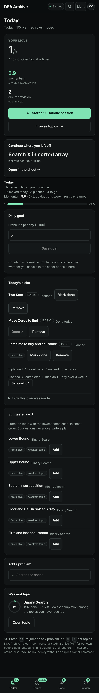
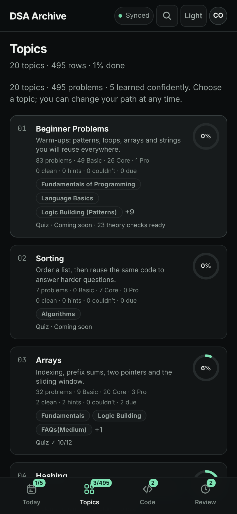
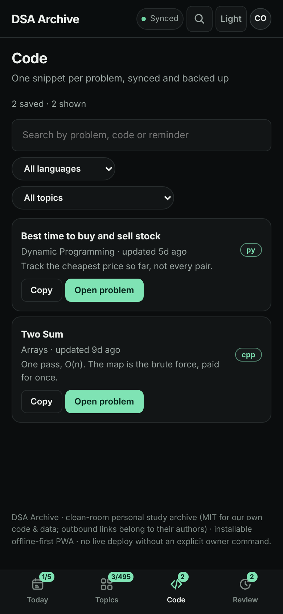
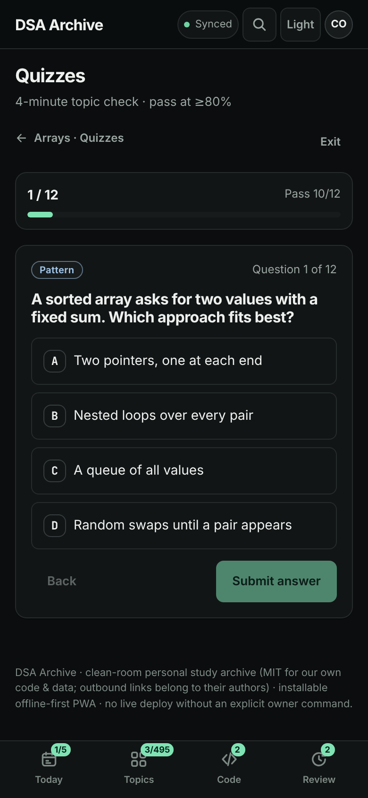
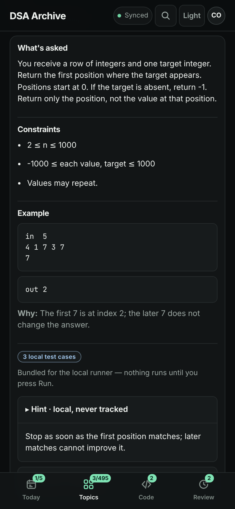
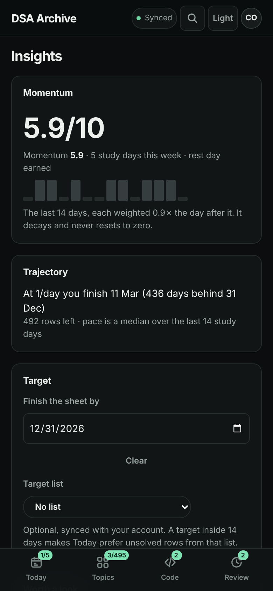

# DSA Archive

**A beginner-first, offline-first DSA workspace** — 495 rows across 20 topics, with
in-app statements and primers, quizzes that explain themselves, a saved-solution
notebook, a code runner that compiles C++/Python/JavaScript *on your own device*, and
a plan that tells you why it picked each row.

Built for the owner and a few invited friends on Firebase's **no-cost Spark plan**
(Auth + Firestore + Hosting only). Personal study data stays in the learner's own
`users/{uid}` tree; the catalogue is a git-validated data file.

> **Status: v2 is complete on the working branch and stopped at the owner's merge
> gate.** Nothing is deployed — deploying the site, the rules or a Hosting preview
> channel is an explicit owner command (`rule.md` §3), and the steps are in
> [`docs/RELEASE-RUNBOOK.md`](docs/RELEASE-RUNBOOK.md). Latest shipped versions:
> Firestore rules **v9**, backup schema **v8** (schemas 1–7 still import).
> What changed and why: [`docs/CHANGELOG.md`](docs/CHANGELOG.md).



## The seven surfaces

| Surface | Where | What it is for |
|---|---|---|
| **Today** | `#/today` | Momentum instead of a streak, today's plan with a reason on every row, plan vs reality, two honest detectors, one-tap goal |
| **Topics** | `#/topics`, `#/topic/<id>` | All 20 topics always visible, with rings, **Learn · Practice · Quiz** tabs and our own primers |
| **Problem & theatre** | `#/problem/<id>` | Our statement, constraints, example, hint, common mistake — and the official YouTube player *inside* the app, with stamps |
| **Code** | `#/code`, plus the Code tab on a problem | One saved solution per problem, synced, searchable, peek-for-recall, copy-out |
| **Review** | `#/review` | The 3 → 7 → 21-day revision queue, with one-tap `Revised ✓` |
| **Quizzes** | `#/quiz`, `#/quiz/<topic>` | 42 theory MCQ cards with per-option explanations, 12-item topic quizzes, 80% pass, synced results |
| **Insights** | `#/insights` | Momentum strip, **one** trajectory sentence, both detectors, and an optional finish line |

Plus `#/search` (the whole sheet, grouped by topic), `#/practice` (pattern drills),
`#/lists`, `#/plans`, `#/stats`, `#/friends`, `#/settings` and a designed 404. Every
screen has a URL, and the back button obeys it.

| Topics | Code | Quizzes |
|---|---|---|
|  |  |  |

| A problem (statement side) | Insights |
|---|---|
|  |  |

More, including desktop and light-theme captures, in
[`docs/screenshots/`](docs/screenshots/README.md) — generated by
`npm run screenshots`, never hand-edited.

## What v1 did, and what v2 changed

v1 was a sheet tracker: rows, filters, progress, planner, revision, friends, offline
install. v2 keeps all of it and changes five things:

| | v1 | v2 |
|---|---|---|
| Structure | one page, tabs, `view` state | a hash router — 16 routes, bookmarkable, back-button correct, sidebar on desktop / bottom bar on phones |
| Learning | links out, only | our own statements, hints, mistakes, primers, quizzes — with a designed "content coming" state wherever content is still being written |
| Notes | markdown notes per problem | **Code**: one saved solution per problem, with peek-for-recall, plus video stamps |
| Video | a link to YouTube | the official player inside our screen, our control bar below it, timeline stamps, per-topic speed memory |
| Code | none | a local runner: Clang 22 (C/C++), Pyodide (Python), native JS, authored test cases with a first diff, instant Stop |

Design system: **tokens v2**, frozen in phase 01 and re-verified in phase 09 — Inter +
JetBrains Mono self-hosted subsets, one accent colour reserved for action, five
semantic roles, colour never the only signal, tabular numbers wherever a number
changes. See [`docs/UI-REFERENCE.md`](docs/UI-REFERENCE.md).

## Honest limits

- **Content is not complete.** The catalogue (495 rows, 20 topics, ranked multi-source
  resources on every row) is done. The beginner layer is authored for **Arrays** and
  partially elsewhere: 1 primer of 20, 6 of 120 beginner statements, 6 of 495
  hints/mistakes, 12 of 240 topic-quiz items, 42 of 42 theory MCQs, 136 practice
  drills. Every screen renders a designed "content coming" state, so nothing waits on
  authoring. The live numbers are in [`docs/content/coverage.md`](docs/content/coverage.md)
  and are regenerated by `npm run content:coverage`.
- **Compilers are large downloads.** C/C++ is 29.0 MB and Python 13.5 MB, fetched only
  if you press Run for that language, cached in `dsa-archive-runtime-v1`, and clearable
  in Settings. JavaScript needs nothing. There is no Java/Go/Rust/TypeScript runner —
  those show a reason and copy-out.
- **Offline is shell-offline.** After the first visit the app opens in airplane mode
  on all 18 routes with your cached progress, statements, quiz and code. A toolchain
  you never installed cannot run offline (the panel says so); an *installed* one can.
- **Video needs the network.** The player is YouTube's; the app never proxies it, and
  offline the theatre shows its designed offline state rather than a blank frame.
- **Ads are your browser's business.** The player is never modified, overlaid or
  blocked (YouTube ToS §4.13). The owner uses Brave; this is a permanent limit.
- **Spark only.** No Cloud Functions, Storage, Realtime DB, Analytics or push. Deleting
  your *account* (as opposed to your data) is out of scope without Functions.
- **Not a judge.** Programs run locally in a sandboxed worker with a 3 s per-case /
  30 s total ceiling and stdout caps. No hidden tests, no verdicts, no scoring.

## Deliberately absent

Notes · video transcripts (fetched or pasted) · ad-blocking · a remote judge
(Judge0/Piston) · AI of any kind · FSRS/attempt-history/readiness analytics · public
signup or leaderboards · a CMS for the catalogue · Tailwind/daisyUI (removed in v2-01
and enforced by `npm run check:deadweight`).

## Privacy, deletion and network

- **Only your data.** Rules v9 give a signed-in user read/write over their own
  `users/{uid}` tree and nothing else. Friends see an **opted-in summary** of counts
  and streak — never saved code, quiz answers or per-row outcomes. Guest browsing
  works signed out, with progress in this browser until you choose to merge it.
- **Delete my data** (Settings → *Account & backup*, two-step) removes
  `progressByTopic`, `snippets`, `quizResults`, `lists`, `plans`, the profile, both
  sides of each friend link, the invite capability and the opt-in public summary, plus
  this device's guest study records. Theme and finish line are device preferences and
  are kept. Proven end-to-end against the Firestore emulator
  (`e2e/account-deletion.spec.ts`); the contract is §7 of
  [`docs/DATA-MODEL.md`](docs/DATA-MODEL.md).
- **No trackers.** No Analytics, App Check, tag manager, ad SDK, telemetry, error
  exporter, third-party script, CDN or font host. The only third-party request in the
  app is YouTube's own player on a problem page that has a video, and
  `e2e/network.spec.ts` asserts that nothing else leaves on the other 16 routes.
- **CSP is enforced** by a Hosting header (`tools/csp.mjs` is the single source,
  byte-checked by `npm run check:csp`). `e2e/csp.spec.ts` drives the report-only stage
  first, asserts zero violations, and only then repeats the core routes with the
  enforced header. The Service Worker bypasses YouTube, the IFrame API, Google/Firebase
  hosts and `/__/auth/*` entirely.

## Repository map

| Path | Role |
|---|---|
| [`rule.md`](rule.md) | Operating manual: laws, gates, clean-room and Spark invariants |
| [`prompt.md`](prompt.md) | Self-contained handoff for the next chat |
| [`docs/CHANGELOG.md`](docs/CHANGELOG.md) | v2.0.0 written for a user, plus the v1 history table |
| [`docs/phases-v2/`](docs/phases-v2/README.md) | Phase contracts `00`–`10`, one folder each, with a `RECORD.md` per executed phase |
| [`docs/phases/`](docs/phases/) | v1 phase records `00`–`06` |
| [`docs/DECISIONS.md`](docs/DECISIONS.md) | Dated owner answers and agent decisions (including every budget re-baseline) |
| [`docs/DATA-MODEL.md`](docs/DATA-MODEL.md) | Catalogue schema, Firestore v5 shape (rules v9 / backup v8), Spark quota, deletion contract |
| [`docs/UI-REFERENCE.md`](docs/UI-REFERENCE.md) | Tokens v2 (final), screen inventory, states matrix |
| [`docs/RELEASE-RUNBOOK.md`](docs/RELEASE-RUNBOOK.md) | Pre-deploy checklist, exact deploy commands, verification and rollback |
| [`docs/content/coverage.md`](docs/content/coverage.md) | The honest content-coverage table (generated) |
| [`docs/RESEARCH.md`](docs/RESEARCH.md) | Specimen audit, reuse scorecard, the pre-written 14-day use test |
| `data/problems.json` | Validated 495-row / 20-topic catalogue (bundled at build) |
| `data/content/`, `data/practice-sets/`, `data/media/` | Authored content, 136 drills, build-time video metadata |
| `src/` | React + TypeScript app, tokens, PWA shell, Vitest suite |
| `e2e/` | Real-Chromium Playwright specs incl. the phase-09 a11y, offline, network, CSP, deletion and performance matrices |
| `tools/` | Validators, rules generator + emulator tests, SW/icon/screenshot builders, budget/CSP/token/dead-weight checks |
| `public/` | Manifest, clean-room `icons/`, `offline.html`, `404.html` |
| `firestore.rules` | Generated, default-deny rules **v9** (emulator-tested in CI) |
| `firebase.json` | Hosting config, cache headers, the enforced CSP, emulator ports |
| `copy-web/` | **STUDY-only** third-party snapshot — never imported, built or deployed |

## Build, test, run

Requires Node ≥22.12, Python 3 (data validation), Java 21 + a Chromium for the
emulator-backed browser suite (CI provides both). The runner toolchains are **fetched,
never committed**: `public/runtime/` is git-ignored by design.

```bash
npm ci
npm run test:data          # 495 rows · 20 topics · links, levels, resources, drills
npm run check:content      # the coverage report matches the data
npm run check:rules        # firestore.rules matches the catalogue (rules v9)
npm test                   # Vitest unit + jsdom UI suite
npm run build:emulator     # TypeScript + Vite build + Service Worker (emulator config)
npm run check:dist         # copy-web/ and third-party assets are absent from dist/
npm run check:links        # built HTML, manifest and resource references resolve
npm run check:budgets      # CSS, JS, shell, fonts, add-ons, Spark transfer
npm run check:hardening    # CSP, token contrast, dead-weight decisions
npm run runtime:fetch      # optional: download the C/C++ (and Python) toolchains
npm run runtime:worker     # bundle the 1.28 MB runner worker (also run by prebuild)
```

Browser, rules and screenshot suites (they need the Firebase Emulator Suite; CI runs
them with `timeout-minutes: 12`):

```bash
npm run test:rules         # Firestore security-rules tests (node --test)
npm run test:emulator      # rules + all Playwright specs against Auth + Firestore
npm run test:e2e           # Playwright only (expects an emulator + a preview server)
npm run screenshots        # regenerate docs/screenshots (emulators + Chromium)
npm run check:screenshots  # assert the committed set exists, is listed and is fresh
```

Local dev against the emulators: `npm run dev:emulator` (add `-- --port 5173` if you
prefer a fixed port). Never point a dev build at the live project.

## Testing and CI

`.github/workflows/ci.yml` runs on every push and pull request in under 12 minutes:
data and content validation, the rules generator parity check, the Vitest suite,
toolchain fetch + worker build, **two** production builds (emulator identifiers and the
live public config), `check:dist`/`check:links`/`check:budgets`/`check:hardening`, the
emulator security-rules tests, and the Playwright matrix at 390×844 and 1440×900 —
including a 6-profile × 18-route axe audit (0 violations), the cold offline matrix, the
network assertion, the CSP report-only → enforce sequence, the delete-my-data proof and
the visual-baseline generator. Every run uploads a downloadable **`site-preview`**
artifact (the built `dist/`, so it really compiles) and the generated visual baselines
for review. A red run names the failing case as an annotation and, on a pull request,
posts a digest — no silent failures.

## Licence and credits

- **Our code and `data/problems.json` extraction (`LICENSE`):** MIT, © 2026 pabi277.
- **Clean room.** The 20-topic / 495-problem syllabus order and titles reflect the
  factual curriculum structure of takeUforward's *"Striver's A2Z DSA Sheet"*. All
  problem statements, articles, practice pages, LeetCode problems and YouTube videos
  remain the property of their authors and platforms and are reached **by linking out**.
  Every statement, hint, primer, quiz and test case in `data/` is our own writing.
  `copy-web/` is study provenance and is **not** covered by the MIT licence.
- **Runtime dependencies shipped in `dist/`:** `react`/`react-dom` 19.3.1 (MIT),
  `firebase` 12.19.0 (Apache-2.0), self-hosted Inter and JetBrains Mono Latin subsets
  (SIL OFL). Opt-in runner toolchains, *not* in `dist/` until `npm run runtime:fetch`:
  `@live-codes/clang-wasm` (MIT, Clang 22) and `pyodide` (MPL-2.0).
- Build/test-only: vite, `@vitejs/plugin-react`, TypeScript, esbuild, Vitest, jsdom,
  `@playwright/test`, `@axe-core/playwright`, `@firebase/rules-unit-testing`,
  firebase-tools. Tailwind and daisyUI were removed in v2-01.
